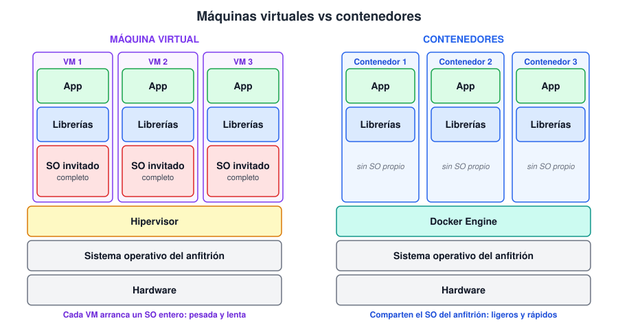
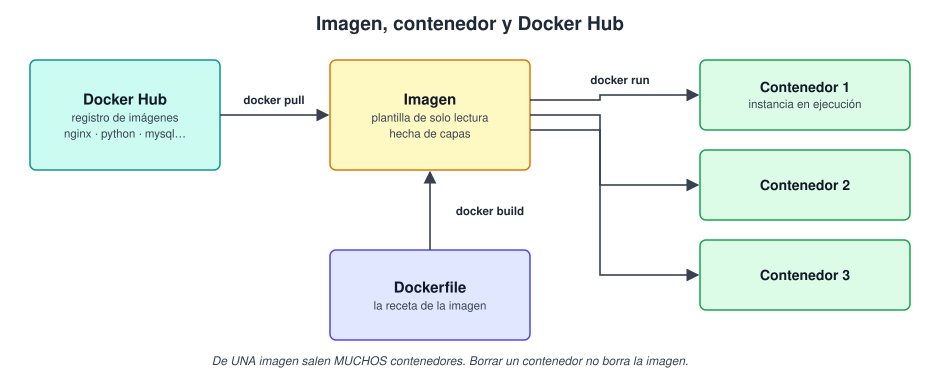
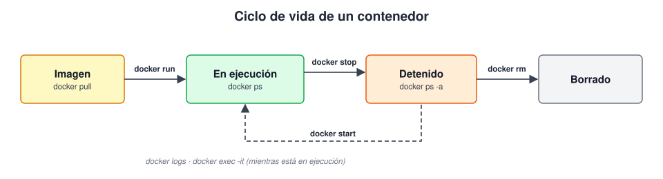
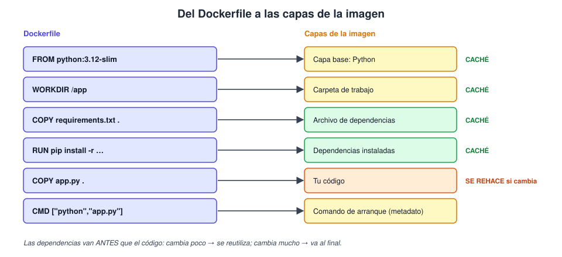
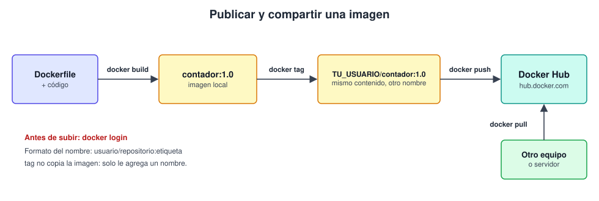
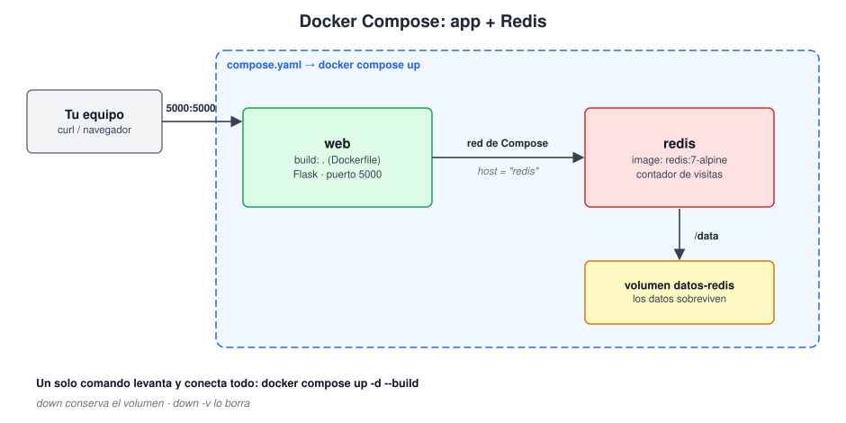

# 🐳 Guía de aprendizaje — Introducción a Docker

## 🎯 Objetivo

Entender qué problema resuelve Docker y adquirir lo básico para usarlo: correr
contenedores, construir tus propias imágenes, publicarlas en Docker Hub y levantar varias
piezas juntas con Docker Compose. Al terminar, deberías poder empaquetar una aplicación
sencilla para que funcione igual en cualquier equipo.

## 🗺️ Ruta de aprendizaje

| # | Tema | Ejemplo práctico |
|---|---|---|
| 1 | [Qué es Docker y para qué sirve](#-1-qué-es-docker-y-para-qué-sirve) | — |
| 2 | [Contenedores vs máquinas virtuales](#-2-contenedores-vs-máquinas-virtuales) | — |
| 3 | [Imágenes, contenedores y Docker Hub](#-3-conceptos-básicos-imágenes-contenedores-y-docker-hub) | [01](ejemplos/01-primeros-contenedores.md) |
| 4 | [Instalación y configuración](#-4-instalación-y-configuración) | [01](ejemplos/01-primeros-contenedores.md) |
| 5 | [Comandos básicos](#-5-comandos-básicos-para-gestionar-contenedores) | [01](ejemplos/01-primeros-contenedores.md) |
| 6 | [Dockerfile](#-6-crear-imágenes-con-dockerfile) | [02](ejemplos/02-dockerfile.md) |
| 7 | [Docker Hub](#-7-docker-hub) | [03](ejemplos/03-publicar-en-docker-hub.md) |
| 8 | [Docker Compose](#-8-introducción-a-docker-compose) | [04](ejemplos/04-compose.md) |

> 📌 **Prerrequisitos:** saber usar una terminal (moverte entre carpetas, ejecutar
> comandos). No hace falta saber programar: el código de los ejemplos ya está escrito.

---

## 🌍 1. Qué es Docker y para qué sirve

> 🔗 **Ejemplos de este concepto**
>
> - [Ejemplo 01](ejemplos/01-primeros-contenedores.md) — un servidor web corriendo en un comando, sin instalar nada más.

### 🌍 Contexto

Todos conocemos la frase *"en mi equipo funciona"*. Una aplicación depende de un sistema
operativo, de versiones de lenguajes y de librerías; cuando algo de eso cambia entre tu
equipo, el de tu compañera y el servidor, la aplicación se rompe.

### 💡 Concepto

**Docker** es una plataforma que empaqueta una aplicación **junto con todo lo que necesita
para ejecutarse** (código, runtime, librerías, configuración) en una unidad llamada
**contenedor**. Ese paquete corre igual en cualquier lugar donde haya Docker.

Analogía: un **contenedor de transporte marítimo**. No importa qué lleve dentro ni si va
en barco, tren o camión: el contenedor tiene siempre la misma forma y se maneja igual.

### 📖 Para qué sirve

| Uso | Qué resuelve |
|---|---|
| **Entornos iguales** | Desarrollo, pruebas y producción ejecutan exactamente lo mismo |
| **Instalar sin ensuciar** | Probar una base de datos o un servidor sin instalarlo en tu equipo; se borra sin dejar rastro |
| **Despliegue rápido** | Un contenedor arranca en segundos |
| **Varias versiones a la vez** | Python 3.9 y 3.12, o dos versiones de MySQL, sin conflictos |
| **Trabajo en equipo** | Quien llegue nuevo levanta el proyecto con un comando |

---

## ⚖️ 2. Contenedores vs máquinas virtuales

> 🔗 **Ejemplos de este concepto**
>
> - [Ejemplo 01](ejemplos/01-primeros-contenedores.md) — `docker run` arranca un contenedor en un instante; compará con lo que tarda arrancar una VM.

Las dos tecnologías **aíslan** aplicaciones, pero a distinto nivel:



| | Máquina virtual | Contenedor |
|---|---|---|
| **Qué virtualiza** | El hardware completo | Solo el espacio de la aplicación |
| **Sistema operativo** | Cada VM trae el suyo | Comparten el del anfitrión |
| **Tamaño** | Gigabytes | Megabytes |
| **Arranque** | Minutos | Segundos |
| **Consumo de recursos** | Alto | Bajo |
| **Aislamiento** | Muy fuerte (SO propio) | Fuerte, pero compartiendo núcleo |
| **Ideal para** | Ejecutar otro SO completo, aislamiento máximo | Empaquetar y desplegar aplicaciones |

> 💡 **No son rivales.** Es común correr contenedores *dentro* de máquinas virtuales (por
> ejemplo, en la nube). En Windows y macOS, Docker Desktop usa una VM ligera por debajo,
> porque los contenedores de Linux necesitan un núcleo Linux.

---

## 📦 3. Conceptos básicos: imágenes, contenedores y Docker Hub

> 🔗 **Ejemplos de este concepto**
>
> - [Ejemplo 01](ejemplos/01-primeros-contenedores.md) — `docker run` descarga una **imagen** y crea un **contenedor** desde ella.
> - [Ejemplo 02](ejemplos/02-dockerfile.md) — construir tu propia imagen y ver sus capas.

| Concepto | Qué es | Analogía |
|---|---|---|
| **Imagen** | Plantilla de **solo lectura** con la aplicación y sus dependencias, hecha de capas | La receta / el molde |
| **Contenedor** | Una **instancia en ejecución** de una imagen | El plato preparado / la pieza hecha con el molde |
| **Registro (registry)** | Servidor donde se guardan y comparten imágenes | Una biblioteca de recetas |
| **Docker Hub** | El registro público por defecto de Docker | La biblioteca más grande |

Lo importante: de **una** imagen se pueden crear **muchos** contenedores, y borrar un
contenedor no borra su imagen.



### 🏷️ Nombre de una imagen

```
nginx:1.27-alpine
  │       └── etiqueta (tag): la versión o variante. Si no la indicás, es `latest`
  └── nombre de la imagen

tu_usuario/contador:1.0     ← en Docker Hub las imágenes propias llevan usuario/
```

> ⚠️ `latest` **no** significa "la más nueva garantizada", solo es la etiqueta por defecto.
> En proyectos reales fijá siempre una versión concreta.

### 🧱 Capas

Una imagen se construye apilando **capas**. Si dos imágenes comparten capas (por ejemplo,
la misma base de Python), Docker las guarda una sola vez. Por eso descargar y construir es
rápido.

---

## 🛠️ 4. Instalación y configuración

> 🔗 **Ejemplos de este concepto**
>
> - [Ejemplo 01](ejemplos/01-primeros-contenedores.md) — `docker run hello-world` es la prueba oficial de que la instalación funciona.

### 🪟🍎 Windows y macOS: Docker Desktop

1. Descargá **Docker Desktop** desde [docker.com/products/docker-desktop](https://www.docker.com/products/docker-desktop/).
2. Instalalo y abrilo (en Windows se apoya en WSL 2; el instalador lo propone).
3. Esperá a que el icono de la ballena indique que Docker está en marcha.

### 🐧 Linux: Docker Engine

Seguí la guía oficial para tu distribución: [docs.docker.com/engine/install](https://docs.docker.com/engine/install/).
Resumen en Ubuntu/Debian con el script oficial:

```bash
curl -fsSL https://get.docker.com | sh
```

### ⚙️ Configuración inicial en Linux

```bash
# Para usar docker sin sudo: agregá tu usuario al grupo docker
sudo usermod -aG docker $USER
# Cerrá la sesión y volvé a entrar (o ejecutá: newgrp docker)

# Que el servicio arranque con el sistema
sudo systemctl enable --now docker
```

> ⚠️ Pertenecer al grupo `docker` equivale a tener permisos de administrador en el equipo.
> Hacelo solo en equipos propios o de confianza.

### ✅ Verificar la instalación

```bash
docker --version          # muestra la versión instalada
docker compose version    # Compose viene incluido en las instalaciones actuales
docker run hello-world    # descarga una imagen mínima y la ejecuta
```

Si `hello-world` imprime *"Hello from Docker!"*, todo está listo.

### 🩹 Problemas frecuentes

| Síntoma | Causa probable | Solución |
|---|---|---|
| `Cannot connect to the Docker daemon` | El servicio no está corriendo | Abrí Docker Desktop, o `sudo systemctl start docker` |
| `permission denied ... docker.sock` | Tu usuario no está en el grupo `docker` | Paso de `usermod` de arriba y reiniciar la sesión |
| `command not found: docker` | No está instalado o no está en el `PATH` | Reinstalá y abrí una terminal nueva |

---

## 💻 5. Comandos básicos para gestionar contenedores

> 🔗 **Ejemplos de este concepto**
>
> - [Ejemplo 01](ejemplos/01-primeros-contenedores.md) — el ciclo completo: ejecutar, listar, ver registros, entrar y borrar.

### 🔄 El ciclo de vida



### 📋 Los comandos del día a día

| Qué querés hacer | Comando |
|---|---|
| Descargar una imagen | `docker pull nginx:alpine` |
| Listar imágenes | `docker images` |
| Crear y arrancar un contenedor | `docker run nginx:alpine` |
| Ver contenedores en ejecución | `docker ps` |
| Ver **todos** (también los detenidos) | `docker ps -a` |
| Detener / arrancar / reiniciar | `docker stop` · `docker start` · `docker restart` `<nombre>` |
| Ver los registros (logs) | `docker logs <nombre>` (`-f` para seguirlos en vivo) |
| Abrir una terminal dentro | `docker exec -it <nombre> sh` |
| Borrar un contenedor | `docker rm <nombre>` (`-f` si está corriendo) |
| Borrar una imagen | `docker rmi <imagen>` |
| Limpiar lo que no se usa | `docker system prune` |

### 🚩 Las opciones de `docker run` que más vas a usar

| Opción | Para qué sirve | Ejemplo |
|---|---|---|
| `-d` | Segundo plano (*detached*) | `docker run -d nginx` |
| `--name` | Ponerle nombre | `--name mi-web` |
| `-p host:contenedor` | Publicar un puerto | `-p 8080:80` |
| `-e CLAVE=valor` | Variable de entorno | `-e MYSQL_ROOT_PASSWORD=secreto` |
| `-v origen:destino` | Montar un volumen o carpeta | `-v datos:/var/lib/mysql` |
| `--rm` | Borrar el contenedor al terminar | `docker run --rm hello-world` |
| `-it` | Modo interactivo con terminal | `docker run -it ubuntu bash` |

### 💾 Los datos y los volúmenes

Lo que se escribe **dentro** de un contenedor se pierde al borrarlo. Para conservar datos
(una base de datos, por ejemplo) se usa un **volumen**:

```bash
docker run -d --name mi-db -e MYSQL_ROOT_PASSWORD=secreto \
  -v datos-mysql:/var/lib/mysql mysql:8
```

Aunque borres `mi-db`, el volumen `datos-mysql` sigue existiendo y se puede reutilizar.

> ⚠️ `docker system prune` y `docker volume rm` **borran datos**. Mirá bien qué vas a
> eliminar antes de confirmar.

---

## 📄 6. Crear imágenes con Dockerfile

> 🔗 **Ejemplos de este concepto**
>
> - [Ejemplo 02](ejemplos/02-dockerfile.md) — construir la imagen de una app Flask y ver la caché de capas.
> - [Dockerfile del ejemplo](ejemplos/app/Dockerfile) — el archivo completo, comentado línea a línea.

Un **Dockerfile** es un archivo de texto con las instrucciones para construir una imagen,
paso a paso. Cada instrucción genera una capa.

```dockerfile
FROM python:3.12-slim              # imagen base
WORKDIR /app                       # carpeta de trabajo dentro de la imagen
COPY requirements.txt .            # copia un archivo del equipo a la imagen
RUN pip install -r requirements.txt   # ejecuta un comando DURANTE la construcción
COPY app.py .
EXPOSE 5000                        # documenta el puerto que usa la app
CMD ["python", "app.py"]           # comando que se ejecuta AL ARRANCAR el contenedor
```

### 📚 Instrucciones principales

| Instrucción | Qué hace |
|---|---|
| `FROM` | Imagen base de la que partís. Siempre es la primera |
| `WORKDIR` | Define la carpeta de trabajo (la crea si no existe) |
| `COPY` | Copia archivos del equipo a la imagen |
| `RUN` | Ejecuta un comando al **construir** (instalar paquetes, compilar) |
| `ENV` | Define una variable de entorno |
| `EXPOSE` | Documenta el puerto (no lo publica; eso lo hace `-p`) |
| `CMD` | Comando por defecto al **ejecutar** el contenedor |

> 💡 **`RUN` vs `CMD`:** `RUN` ocurre una vez, al construir la imagen. `CMD` ocurre cada
> vez que arranca un contenedor.

### 🧱 Del Dockerfile a las capas



### 🔨 Construir y ejecutar

```bash
docker build -t contador:1.0 .     # `-t` = nombre:etiqueta · el `.` es la carpeta con el Dockerfile
docker run -d -p 5000:5000 contador:1.0
```

### ⚡ Buena práctica: ordená las capas por frecuencia de cambio

Docker reutiliza las capas que no cambiaron. Por eso se copian primero las **dependencias**
(cambian poco) y después el **código** (cambia mucho). Si invirtieras el orden, cada cambio
de código reinstalaría todas las dependencias.

### 🙈 `.dockerignore`

Funciona como `.gitignore`: lista lo que **no** se copia a la imagen (`.git/`, `.env`,
carpetas de caché). Hace el build más rápido y evita que se cuelen secretos.

---

## 🌐 7. Docker Hub

> 🔗 **Ejemplos de este concepto**
>
> - [Ejemplo 03](ejemplos/03-publicar-en-docker-hub.md) — etiquetar y subir tu imagen, y volver a bajarla.
> - [Ejemplo 01](ejemplos/01-primeros-contenedores.md) — `docker run nginx` baja la imagen oficial desde Docker Hub.

**Docker Hub** ([hub.docker.com](https://hub.docker.com)) es el registro público donde
viven las imágenes. Cuando hacés `docker run nginx`, la imagen sale de ahí.

### 🔎 Tipos de imágenes

| Tipo | Ejemplo | Cómo reconocerla |
|---|---|---|
| **Oficiales** | `nginx`, `python`, `mysql` | Sin usuario delante; mantenidas por equipos verificados |
| **De la comunidad / de organizaciones** | `bitnami/postgresql` | Con `usuario/` delante |
| **Tuyas** | `tu_usuario/contador` | Las que subís vos |

> ⚠️ Cualquiera puede publicar imágenes. Preferí las **oficiales** o de editores
> verificados, y revisá la página de la imagen antes de usarla.

### 📤 Publicar una imagen propia

```bash
docker login                                   # iniciar sesión
docker tag contador:1.0 TU_USUARIO/contador:1.0    # ponerle el nombre completo
docker push TU_USUARIO/contador:1.0            # subirla
docker pull TU_USUARIO/contador:1.0            # bajarla desde cualquier equipo
```



### 🔐 Sobre seguridad

- Usá un **token de acceso** en lugar de tu contraseña.
- **Nunca** metas contraseñas ni claves dentro de una imagen: quien la baje las vería.
- Los repositorios gratuitos son públicos por defecto: revisá la visibilidad antes de subir.

---

## 🧩 8. Introducción a Docker Compose

> 🔗 **Ejemplos de este concepto**
>
> - [Ejemplo 04](ejemplos/04-compose.md) — una app + Redis levantadas con un solo comando.
> - [compose.yaml del ejemplo](ejemplos/app/compose.yaml) — el archivo completo, comentado.

### 🌍 Contexto

Una aplicación real casi nunca es un solo contenedor: suele haber una web, una base de
datos, una caché… Levantarlos a mano con varios `docker run` (con sus puertos, variables y
redes) es largo y propenso a errores.

### 💡 Concepto

**Docker Compose** te deja describir **todos los servicios de la aplicación** en un solo
archivo (`compose.yaml`) y manejarlos juntos con un comando.

```yaml
services:
  web:
    build: .                 # construye la imagen con el Dockerfile local
    ports:
      - "5000:5000"
    environment:
      REDIS_HOST: redis
    depends_on:
      - redis

  redis:
    image: redis:7-alpine    # usa una imagen ya hecha de Docker Hub
    volumes:
      - datos-redis:/data

volumes:
  datos-redis:
```



### 📖 Qué aporta

- Compose crea una **red** en la que los servicios se encuentran **por su nombre**: `web`
  se conecta a `redis` escribiendo simplemente `redis` como host.
- Define **puertos, variables y volúmenes** en un archivo que se puede versionar.
- **Un comando** para todo, igual para todo el equipo.

### 📋 Comandos de Compose

| Comando | Qué hace |
|---|---|
| `docker compose up -d` | Crea y arranca todos los servicios en segundo plano |
| `docker compose up -d --build` | Igual, reconstruyendo las imágenes |
| `docker compose ps` | Estado de los servicios |
| `docker compose logs -f web` | Registros de un servicio |
| `docker compose stop` / `start` | Detiene / vuelve a arrancar sin borrar |
| `docker compose down` | Detiene y **borra** contenedores y red (conserva los volúmenes) |
| `docker compose down -v` | Además **borra los volúmenes** (se pierden los datos) |

> 💡 Se escribe `docker compose` (con espacio). El antiguo `docker-compose` con guion es la
> versión vieja.

---

## ⚠️ Errores comunes

1. **Confundir imagen y contenedor.** La imagen es la plantilla; el contenedor es lo que
   corre. Borrar uno no borra el otro.
2. **Olvidar publicar el puerto.** Sin `-p`, la aplicación corre pero no se puede abrir
   desde tu navegador.
3. **Guardar datos dentro del contenedor.** Se pierden al borrarlo: usá volúmenes.
4. **Usar `latest` en proyectos reales.** Hoy trae una versión y mañana otra. Fijá la versión.
5. **Meter secretos en el Dockerfile o la imagen.** Pasalos como variables de entorno al ejecutar.
6. **Acumular contenedores detenidos.** Revisá `docker ps -a` y limpiá de vez en cuando.
7. **Copiar el código antes que las dependencias** en el Dockerfile: se pierde la caché.

## 🔤 Glosario rápido

| Término | Significado |
|---|---|
| **Imagen** | Plantilla de solo lectura para crear contenedores |
| **Contenedor** | Instancia en ejecución de una imagen |
| **Registro** | Servidor que almacena imágenes (Docker Hub es uno) |
| **Etiqueta (tag)** | Versión de una imagen (`:1.0`, `:alpine`) |
| **Capa** | Cada paso de un Dockerfile; se guarda y se reutiliza |
| **Volumen** | Almacenamiento persistente fuera del contenedor |
| **Dockerfile** | Receta para construir una imagen |
| **Compose** | Herramienta para definir y correr varios contenedores juntos |

## ✅ Autoevaluación

1. ¿Qué diferencia hay entre una imagen y un contenedor?
2. ¿Por qué un contenedor arranca más rápido que una máquina virtual?
3. ¿Qué hace `-p 8080:80`? ¿Cuál número es el del contenedor?
4. Si borrás un contenedor que guardaba datos sin volumen, ¿qué pasa con los datos?
5. ¿Qué diferencia hay entre `RUN` y `CMD` en un Dockerfile?
6. ¿Por qué en el Dockerfile se copia `requirements.txt` antes que `app.py`?
7. ¿Qué paso falta entre `docker build -t contador:1.0 .` y `docker push` para subir la imagen a tu cuenta?
8. ¿Qué diferencia hay entre `docker compose down` y `docker compose down -v`?

<details>
<summary><strong>🔑 Ver respuestas</strong> (clic para desplegar)</summary>

1. La imagen es la plantilla de solo lectura; el contenedor es una instancia en ejecución de ella.
2. Porque no arranca un sistema operativo completo: comparte el núcleo del anfitrión.
3. Publica el puerto 80 del contenedor en el 8080 de tu equipo. El del contenedor es el **80** (el de la derecha).
4. Se pierden junto con el contenedor.
5. `RUN` se ejecuta al construir la imagen (una vez); `CMD` se ejecuta cada vez que arranca un contenedor.
6. Para aprovechar la caché: las dependencias cambian poco y el código mucho; así solo se rehace la capa del código.
7. `docker tag contador:1.0 TU_USUARIO/contador:1.0` (y haber hecho `docker login`).
8. `down` conserva los volúmenes (los datos); `down -v` también los borra.

</details>

## 🏋️ Ejercicio final

Con lo visto, hacé el recorrido completo:

1. Cloná o copiá la carpeta [ejemplos/app/](ejemplos/app/).
2. Construí la imagen y levantá la app con Compose; comprobá que el contador sube.
3. Hacé `docker compose down` y luego `up -d`: ¿el contador continúa? ¿Por qué?
4. Cambiá el mensaje de `app.py`, reconstruí con `docker compose up -d --build` y fijate en
   qué capas se reutilizan.
5. *(Opcional)* Publicá la imagen en tu cuenta de Docker Hub siguiendo el [ejemplo 03](ejemplos/03-publicar-en-docker-hub.md).

## 📚 Para seguir aprendiendo

- Documentación oficial: [docs.docker.com](https://docs.docker.com/)
- Practicar en el navegador, sin instalar nada: [labs.play-with-docker.com](https://labs.play-with-docker.com/)
- Siguientes temas: redes entre contenedores, *multi-stage builds*, variables con archivos `.env`, orquestación con Kubernetes.

## 🗂️ Contenido de esta carpeta

```
skill-docker/
├── README.md                        ← esta guía
├── img/                             ← diagramas SVG de la guía
└── ejemplos/
    ├── 01-primeros-contenedores.md
    ├── 02-dockerfile.md
    ├── 03-publicar-en-docker-hub.md
    ├── 04-compose.md
    └── app/                         ← app de ejemplo (Flask + Redis)
        ├── app.py
        ├── requirements.txt
        ├── Dockerfile
        ├── .dockerignore
        └── compose.yaml
```
